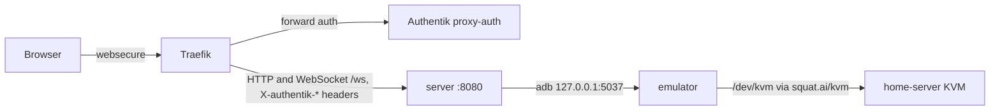

# Android emulator

One Android Emulator runs in the cluster with KVM acceleration; its screen is
streamed to a web page at `android.luukblankenstijn.nl`. Every Authentik user
who passes forward auth can watch it; members of `infra-admins` can control it.
The images are built in `LuukBlankenstijn/android-emul`.

| Host | Target | Access |
| --- | --- | --- |
| `android.luukblankenstijn.nl` | Service `android-emul/android-emul:8080` | Middleware `authentik/proxy-auth`; control only for group `infra-admins` |

## Workload

`flux/50_apps/android-emul/deployment.yaml`: Deployment `android-emul`, one
replica, strategy `Recreate` (the volume is ReadWriteOnce). Namespace
`android-emul` enforces Pod Security `baseline`; the emulator runs as
uid 1300 / gid 1301 (the image's `androidusr`), the server as uid and gid 1000.

| Container | Image | Does |
| --- | --- | --- |
| `emulator` | `budtmo/docker-android:emulator_14.0_v3.8.0-p1` | Android 14 emulator (Google APIs, x86_64 with ARM translation) and the adb server; usage analytics off via `USER_BEHAVIOR_ANALYTICS=false` |
| `server` | `ghcr.io/luukblankenstijn/android-emul-server` | web UI and WebSocket `/ws` on 8080, talks to the adb server on `127.0.0.1:5037`, so it shares the pod; read-only root filesystem |

The server reads the user from `X-authentik-username` and the groups from
`X-authentik-groups`, which `proxy-auth` passes on; `ADMIN_GROUP=infra-admins`
grants control.

The emulator requests `squat.ai/kvm: 1` instead of running privileged; the
[KVM device plugin](#kvm-device-plugin) mounts `/dev/kvm` into the container.
It requests 2 CPUs and 5 Gi of memory, limited to 7 Gi.

| Probe | Emulator | Server |
| --- | --- | --- |
| startup | `adb shell getprop sys.boot_completed` every 10 s, up to 60 failures (10 minutes; a first boot takes about 2) | - |
| readiness | `adb shell getprop sys.boot_completed` every 30 s | `GET /healthz` |
| liveness | `adb get-state` every 30 s, 3 failures | `GET /healthz` |

Liveness only checks that the adb server answers, not that Android has booted:
a reboot triggered from the UI takes longer than the 90 s liveness window and
must not restart the container. During such a reboot the pod is not ready.

Longhorn volume `data` (24 Gi, `pvc.yaml`) is mounted on
`/home/androidusr/emulator`, where the image keeps the AVD; the image reuses an
existing AVD on start, so installed apps survive restarts.

The container command wraps the image's `run.sh`. It skips the image's
`sudo chown /dev/kvm` step, which also deletes `root` from `/etc/passwd` and
cannot run with `allowPrivilegeEscalation: false` (`/dev/kvm` is world-writable
on the node anyway). It also rewrites `~/.android/avd/device.ini`, which lives
outside the volume, and clears stale lock files. `EMULATOR_HEADLESS` with
`-no-window` drops the image's X server and unauthenticated VNC.

## KVM device plugin

`flux/20_controllers/generic-device-plugin`: DaemonSet
`ghcr.io/squat/generic-device-plugin` in namespace `generic-device-plugin`
(Pod Security `privileged`, for the hostPath volumes). It registers with the
kubelet through `/var/lib/kubelet/device-plugins` and announces one device
`squat.ai/kvm` while `/dev/kvm` exists on the node (`kvm-amd` on
`home-server`). The container is not privileged; it only needs to see `/dev`.

## Authentik

Forward auth needs a proxy provider for this host, created in the Authentik
UI like the other forward-auth apps (not in OpenTofu):

1. Applications → Providers → Create → Proxy Provider, mode *Forward auth
   (single application)*, external host `https://android.luukblankenstijn.nl`.
2. Applications → Create an application `android-emul` with that provider.
3. Outposts → the embedded outpost → add the application.

Without it, `proxy-auth` rejects every request to the host.

## Alerts

| Alert | Fires when |
| --- | --- |
| `AndroidEmulWorkloadDown` | Deployment `android-emul` has no available replica for 15 minutes |
| `AndroidEmulContainerRestarting` | a container in `android-emul` restarted more than twice in an hour |
| `KvmDeviceUnavailable` | `home-server` offers no allocatable `squat.ai/kvm` for 15 minutes |
| `PublicEndpointDown`, `PublicCertificateExpiringSoon` | the blackbox probe of `https://android.luukblankenstijn.nl/` fails or its certificate is about to expire |
