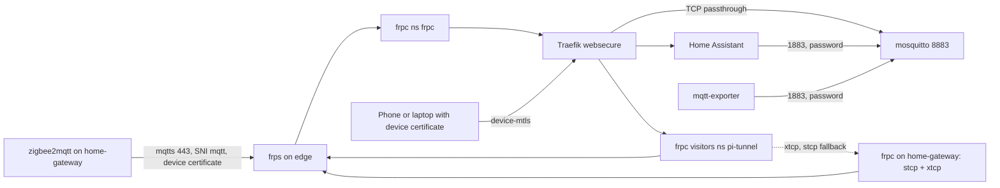

# Home Assistant

Home Assistant and its MQTT broker run in the cluster. The Zigbee radio sits on
`home-gateway`, a Raspberry Pi on the home LAN (see [NixOS hosts](../hosts.md))
that runs zigbee2mqtt. Both directions between the Pi and the cluster go through
the edge VPS, so neither depends on NetBird.

| Host | Target | Access |
| --- | --- | --- |
| `home-assistant.luukblankenstijn.nl` | Service `home-assistant/home-assistant` | TLSOption `traefik/device-mtls`, then Home Assistant's own login |
| `zigbee2mqtt.luukblankenstijn.nl` | Service `pi-tunnel/zigbee2mqtt`, the zigbee2mqtt frontend on `home-gateway` | TLSOption `traefik/device-mtls` |
| `mqtt.luukblankenstijn.nl:443` | mosquitto `8883`, TLS passed through by Traefik | client certificate checked by mosquitto |

## Home Assistant

`flux/50_apps/home-assistant/home-assistant.yaml`: one replica of
`ghcr.io/home-assistant/home-assistant` with Longhorn volume `config` on
`/config`. Namespace `home-assistant` enforces Pod Security `baseline`, because
the image runs as root.

An initContainer copies `configuration.yaml` from ConfigMap `home-assistant` on
every start, so that file is owned by git; edits in the pod are lost. It includes
the UI-managed `automations.yaml`, `scenes.yaml` and `scripts.yaml`, which it creates
empty when missing. Everything else (integrations, users, history) lives in
`.storage` on the volume.

The `http` integration is configured in the UI (Settings → System → Network),
since YAML for it is deprecated: use `X-Forwarded-For` and trust the pod CIDR
`10.42.0.0/16` (Traefik), otherwise Home Assistant rejects proxied requests with
400. A new volume needs this set once; until then reach it with
`kubectl -n home-assistant port-forward deploy/home-assistant 8123`.

The MQTT integration is set up once in the UI: broker
`mosquitto.home-assistant.svc`, port `1883`, user `home-assistant`, password
`home_assistant_password` from OpenBao `secret/home-assistant/mqtt`.
zigbee2mqtt publishes Home Assistant discovery under `homeassistant/`.

## Mosquitto

`flux/50_apps/home-assistant/mosquitto.yaml`, `eclipse-mosquitto` with
`per_listener_settings`:

| Listener | Authentication | Who |
| --- | --- | --- |
| `1883` | password file | `home-assistant` (all topics), `exporter` (read `zigbee2mqtt/bridge/state`) |
| `8883` | client certificate, `use_identity_as_username` | `home-gateway.devices.luukblankenstijn.nl` (`zigbee2mqtt/#`, `homeassistant/#`) |

- **Server certificate:** cert-manager Certificate `mqtt-tls` for
  `mqtt.luukblankenstijn.nl` (ClusterIssuer `letsencrypt-dns`).
- **Client CA:** `device-hosts-ca` from OpenBao
  `secret/home-assistant/device-hosts-ca` (SecretStore `pki`, role
  `pki-home-assistant`), written by `terraform/50_pki`: the hosts intermediate
  and the device root. OpenSSL needs the root to accept a chain, so any device
  certificate passes the handshake; the ACL only grants topics to
  `home-gateway`, so other devices can connect but neither read nor write.
- **Passwords and ACL:** an initContainer copies the ACL and hashes `home_assistant_password` and
  `exporter_password` from `secret/home-assistant/mqtt` into an in-memory
  password file.
- **Reload:** mosquitto reads certificates, CA and ACL only at start and on
  SIGHUP, and wants the ACL owned by itself with mode 0600, so it reads a copy in
  the in-memory `auth` volume. The sidecar `reload` shares the pod's process
  namespace and hashes the ConfigMap ACL, certificate, key and CA every minute;
  on a change it refreshes the ACL copy and sends `SIGHUP`, so cert-manager
  renewals, CA and ACL changes take effect without a restart. A change to
  `mosquitto.conf` needs a rollout restart.
- **NetworkPolicy `mosquitto`:** `8883` only from namespace `traefik`, `1883`
  only from the Home Assistant and exporter pods.

IngressRouteTCP `mqtt` matches `HostSNI(mqtt.luukblankenstijn.nl)` on
`websecure` with `passthrough: true`, so MQTT uses the existing 443 forward on
the edge.

## The Pi tunnel

The cluster reaches services on `home-gateway` through frp secret proxies; no
port is opened on the edge and nothing listens publicly.

- **On `home-gateway`** (`nix/hosts/home-gateway/frp.nix`, unit
  `frp-pi-tunnel.service`): an frpc client that registers, per target, an
  `stcp` proxy `<target>` and an `xtcp` proxy `<target>-p2p` with the same
  secret key.
- **In the cluster** (`flux/40_services/pi-tunnel`): an frpc with only visitors.
  Per target, an `xtcp` visitor listens on `0.0.0.0:<port>` and tries a direct
  connection first (NAT hole punching with the public STUN server
  `stun.easyvoip.com:3478`; frp needs RFC 5780 `OTHER-ADDRESS`, which the edge's
  coturn cannot give with a single IP); when that does not succeed within one
  second it falls back to the `stcp` visitor `<target>-relay`, which relays
  through frps. `keepTunnelOpen` keeps the direct tunnel up between requests.
  A Service per target points at the visitor port.

| Target | Pi port | Service |
| --- | --- | --- |
| `zigbee2mqtt` | `127.0.0.1:8080` | `pi-tunnel/zigbee2mqtt:8080` |

A new target is one entry in `targets` in `frp.nix`, two visitors in
`flux/40_services/pi-tunnel/deployment.yaml`, a container port and a Service.

Both frpc clients use the shared frp token. The secret key is
`pi-tunnel-secret-key` in `secrets/home-gateway.yaml`; `40_openbao-config`
copies it and the token to `secret/pi-tunnel/frp`.

## zigbee2mqtt

`nix/hosts/home-gateway/zigbee2mqtt.nix`:

| Setting | Value |
| --- | --- |
| Adapter | SONOFF Dongle Plus MG24, `ember`, 115200 baud, by-id path |
| MQTT | `mqtts://mqtt.luukblankenstijn.nl:443` with the host's device certificate from `cfg.deviceCert` |
| Frontend | `127.0.0.1:8080`, reached only through the tunnel |
| Home Assistant discovery | on |

zigbee2mqtt reads the certificate only when it starts. The path unit
`zigbee2mqtt-device-cert` restarts it whenever OpenBao Agent writes a renewed
certificate.

## Alerts

| Alert | Fires when |
| --- | --- |
| `HomeAssistantWorkloadDown` | a Deployment in `home-assistant` or `pi-tunnel` has no available replica |
| `PublicEndpointDown`, `PublicCertificateExpiringSoon` | the blackbox TLS probe of `mqtt.luukblankenstijn.nl:443` fails or the certificate mosquitto serves is about to expire |

`mqtt-exporter` (`hikhvar/mqtt2prometheus`) subscribes to
`zigbee2mqtt/bridge/state` and exports `zigbee2mqtt_bridge_online` (1 online,
0 otherwise). The value never expires from its cache and carries no timestamp,
so the retained message keeps it current.
