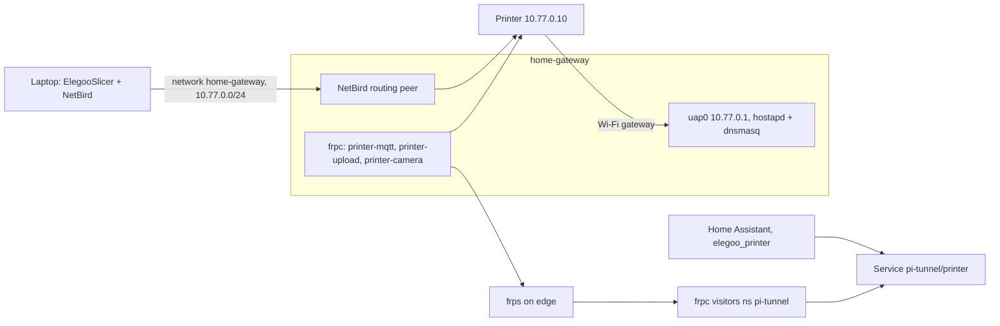

# 3D printer

An Elegoo Centauri Carbon 2 on its own Wi-Fi network, served by `home-gateway`
next to it. Home Assistant reaches it through the [Pi tunnel](home-assistant.md#the-pi-tunnel);
a laptop running the slicer reaches it over NetBird.



## What the printer serves

Stock firmware, LAN Only Mode:

| Port | Service | Authentication |
| --- | --- | --- |
| UDP 52700 | discovery | none |
| TCP 1883 | MQTT broker on the printer: status and control, about 4 clients at most | user `elegoo`, the access code set on the touchscreen |
| TCP 9001 | the same broker over WebSocket, used by the slicer's device page | as 1883 |
| TCP 80 | `PUT /upload` for G-code, nothing else | none |
| TCP 8080 | MJPEG camera on every path, usually one viewer at a time | none |

Home Assistant uses one MQTT slot, the slicer two (1883 and 9001).

## Access point on home-gateway

`nix/hosts/home-gateway/printer.nix`, addresses in `printer-network.nix`.

The Pi 4's radio runs one client and one access point only on a single channel,
so the access point `uap0` always takes `wlan0`'s channel and band; with
CasaGooch4 that is 5 GHz channel 104 (DFS), or its 2.4 GHz band if `wlan0` lands
there. The printer has to join on whatever band that is. While `uap0` exists the
radio cannot scan, so `wlan0` cannot find the router again after a disconnect;
the access point therefore runs only while `wlan0` is connected.

| Unit | Does |
| --- | --- |
| `printer-ap-guard.service` | the only thing that starts or stops `printer-ap`. Every 10 s: if `wlan0` is not connected it stops `printer-ap` at once and restarts `wpa_supplicant-wlan0`, which stops scanning after the scans the access point made fail. If `wlan0` is connected and its default gateway answers, it starts `printer-ap`, or restarts it when `uap0`'s frequency differs from `wlan0`'s (router changed channel or band). Counts checks without a working uplink: after 2 minutes it restarts `wpa_supplicant-wlan0`, after 4 minutes it reloads `brcmfmac`, after 6 minutes it reboots, but only when the Pi has been up for 30 minutes |
| `printer-ap.service` | started by the guard only: requires `wlan0` to be connected and takes its frequency from `iw dev wlan0 link`, adds `uap0` (MAC derived from `wlan0`'s), sets `10.77.0.1/24`, writes `/run/printer-ap/hostapd.conf` with the passphrase from `printer-wifi-psk` and runs hostapd; WPA2-PSK, SSID `gateway` |
| `dnsmasq.service` | DHCP on `uap0` only, no DNS. `10.77.0.10` is reserved for the printer's MAC (`printerMac` in `printer-network.nix`, `88:49:2d:75:42:2d`); any other client gets `10.77.0.100`–`10.77.0.110`. Router `10.77.0.1`, DNS `1.1.1.1`, `9.9.9.9` |

With DFS, hostapd logs `Wait for CAC to complete` and never `AP-ENABLED`; the
firmware handles radar detection itself and the access point serves clients
anyway. dhcpcd ignores `uap0`.

Firewall (iptables): on `uap0` the Pi additionally opens DHCP (UDP 67); SSH and ping are open on every interface. `networking.nat`
masquerades the printer's traffic out of `wlan0`, so it reaches the internet
(firmware updates, time); chain `printer-forward` drops anything it starts towards
`10.0.0.0/8`, `172.16.0.0/12`, `192.168.0.0/16` and `100.64.0.0/10`, so not the
home LAN, the cluster or NetBird. Replies to connections from the Pi or from
NetBird pass.

The passphrase:

```sh
sops -d --extract '["printer-wifi-psk"]' secrets/home-gateway.yaml
```

## Home Assistant

The integration is [elegoo-homeassistant](https://github.com/danielcherubini/elegoo-homeassistant)
(`elegoo_printer`). The initContainer `elegoo-printer` in
`flux/50_apps/home-assistant/home-assistant.yaml` downloads the release archive
named in `ELEGOO_PRINTER_URL` into `/config/custom_components/elegoo_printer`
whenever that URL differs from the one recorded in `.source` there; Renovate's
regex manager for GitHub archive URLs bumps it.

Home Assistant reaches the printer through Service `pi-tunnel/printer`, which
forwards the printer's own ports:

| Service port | Pi tunnel target | Printer |
| --- | --- | --- |
| 1883 | `printer-mqtt` | `10.77.0.10:1883` |
| 80 | `printer-upload` | `10.77.0.10:80` |
| 8080 | `printer-camera` | `10.77.0.10:8080` |

Set up once in the UI, with the printer in LAN Only Mode (Settings → Network on
the touchscreen) and an access code set:

1. Settings → Devices & services → Add integration → Elegoo Printers, configure
   manually.
2. IP address `10.77.0.10`, Proxy Host `printer.pi-tunnel.svc.cluster.local`,
   the access code.
3. In the entry's options, tick "Printer is often switched off" if it hangs on a
   smart plug.

Discovery is skipped through a proxy host; the integration learns the serial
number from the printer's MQTT status or asks for it (label on the printer,
Settings → Network).

`light.room_3d_printer_chamber_light` is hidden, so the Lights panel and area
targets such as `presence_away_lights_off` (`area_id: bedroom`) leave it alone;
the camera needs it while printing. The Printer view controls it directly.

Entities are named `*.room_3d_printer_*`; the camera is
`camera.room_3d_printer_chamber_camera`. The dashboard `dashboard-home` has a
view `printer` (camera, print status and controls, temperatures and fans, failure
detection), edited through the UI or the websocket API like the rest of the
dashboard.

## Failure detection

Home Assistant's AI Task sends a camera frame to Ollama (`flux/50_apps/ollama`,
on the GPU node; `qwen3.5:4b-q4_K_M`, the model already loaded there). Set up once in the UI:
Add integration → Ollama, URL `http://ollama-ollama.ollama.svc:11434`, no API
key; in the AI Task entry, model `qwen3.5:4b-q4_K_M`, context window 4096 (the
size Ollama keeps the model loaded with, so the request does not force a
reload), thinking off, keep alive -1. That gives `ai_task.ollama_ai_task`.

Like all automations and helpers, these live on the volume, not in git:

| Automation | Does |
| --- | --- |
| `printer_ai_check` | every 3 minutes, while `input_boolean.printer_ai_check` is on, `sensor.room_3d_printer_print_status` is `printing` and the layer is above 10: asks `ai_task.generate_data` for a `reason` and a `defect` (`none`, `spaghetti`, `detached`, `empty_bed`, `layer_shift`, `blob`) with the camera frame attached, and stores both in `input_text.printer_ai_defect` and `input_text.printer_ai_reason`. Anything but `none` increments `counter.printer_ai_strikes`, `none` resets it. At 3 strikes it presses `button.room_3d_printer_pause_print` and sends a normal-priority notification to `notify.mobile_app_phone` with the live camera image and Resume and Stop actions |
| `printer_ai_notification_action` | presses resume or stop when a notification action is tapped |
| `printer_ai_reset` | resets the strikes and the stored verdict when a print starts or ends |

The verdict comes from `defect` alone. While printing, `empty_bed` means the part
came off, so it counts as a failure. The model answers in about 2–5 s. On a bare
bed it gives `empty_bed` or `none`, with an occasional stray failure label, which
is why it takes 3 strikes in a row and starts above layer 10, when the part is
visible from the camera's angle.

## Slicer

The laptop reaches `10.77.0.0/24` over NetBird: `60_netbird-config` declares the
network `home-gateway` with resource `printer-lan` (`10.77.0.0/24`, group
`printer`) and the policy `admins-to-printer` (see [NetBird](../cluster/netbird.md#networks)).
The routing peer, `home-gateway` with masquerade on, is assigned in the
dashboard under Networks → `home-gateway`.

ElegooSlicer (Linux AppImage) adds the printer by IP `10.77.0.10` with the access
code; uploads, the device page and the camera go straight to the printer.

## Alerts

| Alert | Fires when |
| --- | --- |
| `PrinterAccessPointDown` | `node_network_up{device="uap0"}` on `home-gateway` is 0 or missing for 15 minutes while the Pi reports metrics |
| `HomeAssistantWorkloadDown` | the frpc Deployment in `pi-tunnel` has no available replica |
| `OllamaDown` | Ollama has no available replica for 15 minutes, so the failure check cannot run |

The printer itself is often off, so its reachability is not alerted on.
