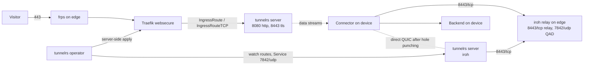

# tunnelrs

[tunnelrs](https://github.com/LuukBlankenstijn/tunnelrs) exposes HTTP and TLS
services on devices outside the cluster. A connector on the device dials the
tunnelrs server over iroh (QUIC), announces the hostnames it serves, and the
server forwards visitor traffic back over that session. The operator turns the
server's routes into Traefik IngressRoutes.



## Components

`flux/40_services/tunnelrs`, namespace `tunnelrs` (Pod Security `restricted`).

| What | Details |
| --- | --- |
| `tunnelrs-server` Deployment | image `ghcr.io/luukblankenstijn/tunnelrs/server`, one replica, `strategy: Recreate`. Grants, enrollment and the last announcement per connector live in SQLite on Longhorn volume `state` |
| Service `tunnelrs` | `8080/tcp` plain HTTP for terminate routes, `8443/tcp` TLS passthrough routes, `7842/udp` iroh for the in-cluster operator |
| `tunnelrs-operator` Deployment | image `ghcr.io/luukblankenstijn/tunnelrs/operator`; watches the server's routes and server-side applies an `IngressRoute` (terminate) or `IngressRouteTCP` with TLS passthrough (passthrough) per hostname in namespace `tunnelrs`, labelled `app.kubernetes.io/managed-by=tunnelrs-operator`. Role: Traefik `ingressroutes`/`ingressroutetcps` and `events` in `tunnelrs` only |

Terminate routes get TLS on `websecure` from the default TLSStore certificate, so
only hostnames under `luukblankenstijn.nl` get a valid certificate. Passthrough
routes need their own certificate on the backend.

The server and the connectors reach each other through the public iroh relay on
the edge, `https://relay.luukblankenstijn.nl:8443` (`[iroh] relays` in
`server.toml`); see [Edge and public ingress](../cluster/edge.md). Both learn
their public addresses from the relay's QUIC address discovery on `7842/udp` and
connect directly when the NATs allow hole punching; otherwise the traffic stays
relayed. The cluster takes no inbound UDP: the `7842/udp` Service port is only
for the operator, which dials `tunnelrs.tunnelrs.svc.cluster.local:7842`.

## Identities

Every party is an iroh key; the public half is its ID.

| Key | ID | Role |
| --- | --- | --- |
| server | `5387b0ee57707157ac4b3107c339e88659913bc2cb32b90dd6f0a0bf9d764d62` | the ID connectors and the operator dial |
| operator | `311647e83ce93f3747adb8e7867fcbe9b9cf55ecd9f117b4c093bf47f44a3f5b` | `watcher`: route watch stream only |
| ctl | `7009ade18de0f5c077a42b210dd99bf55ab17a8b440c67a057b6b196ec148866` | `admin`: approve, deny, revoke, forget |

The private keys are `tunnelrs.server_key`, `tunnelrs.operator_key` and
`tunnelrs.ctl_key` in `secrets/apps.yaml`. `terraform/40_openbao-config` copies
them to `secret/tunnelrs/keys`; ExternalSecrets `tunnelrs-server-keys` (server,
ctl) and `tunnelrs-operator-key` mount them read-only.

## Enrolling a connector

A new connector shows up as `pending` with the hostnames it asked for and gets
no traffic until it is approved:

```bash
ctl() { kubectl -n tunnelrs exec deploy/tunnelrs-server -- tunnelrs-ctl --config /etc/tunnelrs/config/ctl.toml "$@"; }
ctl list
ctl approve <connector-id>
ctl approve <connector-id> --hosts '*.lab.luukblankenstijn.nl'
ctl routes
ctl revoke <connector-id>
ctl forget <hostname>
```

`approve` without `--hosts` grants exactly the hostnames the connector
requested; approving again replaces the grant. `revoke` closes the connector's
session at once. A route whose connectors are all offline answers 503 and keeps
its hostname for 24 hours, then it is withdrawn and the operator deletes its
IngressRoute.

## Connector on a device

NixOS, with the tunnelrs flake as input `tunnelrs`:

```nix
imports = [ inputs.tunnelrs.nixosModules.default ];
services.tunnelrs.useBinaryCache = true;
services.tunnelrs.connector = {
  enable = true;
  server = {
    id = "5387b0ee57707157ac4b3107c339e88659913bc2cb32b90dd6f0a0bf9d764d62";
    relays = [ "https://relay.luukblankenstijn.nl:8443" ];
  };
  exposures."app.luukblankenstijn.nl".backend = "127.0.0.1:8080";
};
```

The connector generates its key in `/var/lib/tunnelrs-connector` on first start
and logs its ID with the `tunnelrs-ctl approve` command to run. Elsewhere, run
`ghcr.io/luukblankenstijn/tunnelrs/connector` with `--config` pointing at the
same settings in TOML (`key_path`, `[server] id, relays`, `[[expose]] hostname, backend, tls`).

## Alerts

| Alert | Fires when |
| --- | --- |
| `TunnelrsDown` | `tunnelrs-server` or `tunnelrs-operator` has no available replica for 5 minutes |
| `IrohRelayDown` | the blackbox probe of `https://relay.luukblankenstijn.nl:8443/healthz` fails or is missing for 5 minutes, so connectors cannot reach the server through the relay |
