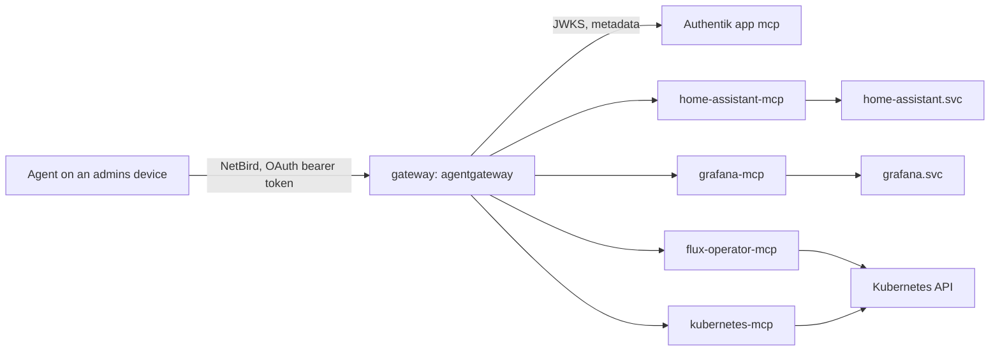

# MCP gateway

AI agents reach the infrastructure through one MCP endpoint,
`http://mcp.peers.luuk.internal:3000/mcp`, reachable only over NetBird. Agents
log in through Authentik in the browser and never see a backend credential: each
MCP server behind the gateway holds its own, delivered from OpenBao by
external-secrets. Everything lives in `flux/80_agents` (namespace `agents`).

The limits below guard against agent mistakes. They are not a security boundary:
an agent on a laptop of an admin also has that admin's `kubectl`.

## Connecting

The repository's `.omp/mcp.json` defines the server `infra`. The first
connection opens the Authentik login in the browser (`/mcp reauth infra`
repeats it); the client registers as the pre-registered public client `mcp`,
whose redirect URIs accept any `http://localhost:<port>/callback` or
`http://127.0.0.1:<port>/callback`. Other MCP clients use the same URL with
client ID `mcp`.

`.omp/config.yml` makes omp ask before `kubernetes_pods_exec`,
`flux_delete_kubernetes_resource` and `flux_suspend_flux_reconciliation`.

## Gateway

Deployment `gateway`, `cr.agentgateway.dev/agentgateway`, config in ConfigMap
`gateway` (simplified `mcp:` form):

| Setting | Value |
| --- | --- |
| Listener | port 3000, path `/mcp` |
| Authentication | `mcpAuthentication` with provider `authentik`, issuer `https://auth.luukblankenstijn.nl/application/o/mcp/`, audience and `clientId` `mcp`. Open source Authentik has no dynamic client registration; the gateway answers registration requests with client `mcp` |
| Authorization | `mcpAuthorization`: only tokens whose `groups` contain `infra-admins` see and call tools. The Authentik application is bound to that group too |
| Tool names | `prefixMode: always`: `<target>_<tool>`, targets `homeassistant`, `grafana`, `flux`, `kubernetes` |
| Session key | `SESSION_KEY` from `secret/agents/gateway` (`session_key`) |
| Access log | JSON on stdout, one line per MCP request with `gen_ai.tool.name`, `mcp.target` and `user` (the token's `preferred_username`) |
| Metrics | port 15020 `/metrics`, scraped through the pod annotation; readiness on 15021 `/healthz/ready` |

The pod carries label `netbird-peer: mcp`. SidecarProfile `agents/gateway`
injects a NetBird client with setup key `agents/gateway-sidecar` (ephemeral,
auto-group `mcp`, extra DNS label `mcp`), so the gateway is the peer
`mcp.peers.luuk.internal`; policy `admins-to-mcp` lets `admins` reach it. The
protected-resource metadata names `http://mcp.peers.luuk.internal:3000/mcp`, so
the gateway must be reached by that name.

## MCP servers

NetworkPolicy `upstreams` admits traffic to the MCP servers only from the
gateway, and to port 9090 from namespace `observability`.

| Target | Deployment | Credential | Can |
| --- | --- | --- | --- |
| `homeassistant` | `home-assistant-mcp`, `ghcr.io/homeassistant-ai/ha-mcp` (`ha-mcp-web`, port 8086) | Home Assistant long-lived token, `secret/agents/home-assistant` | everything the token's user can: entities, automations, scripts, helpers, dashboards, history. The settings UI is off |
| `grafana` | `grafana-mcp`, `grafana/mcp-grafana` (streamable HTTP, port 8000) | Grafana service account `mcp` (Editor), `secret/agents/grafana`; callers must present `grafana_mcp_token` from `secret/agents/gateway`, which the gateway sends | queries against Mimir and Loki, dashboards, folders, annotations, alert silences. `--disable-write` with exceptions `update_dashboard`, `create_folder`, the annotation tools and `alerting_silences_write`; no datasource or Grafana alert rule changes |
| `flux` | HelmRelease `flux-operator-mcp` (port 9090) with chart RBAC off; its ServiceAccount is bound to `view` and to ClusterRole `agents-operator` (`flux-mcp.yaml`): all verbs on core resources except Secrets and `pods/exec`, and on the workload, Flux and operator CRD groups listed there; read-only on CRDs, storage, admission policies and RBAC | none | Flux status, trace, diff, reconcile, suspend, resume; get, apply, patch and delete objects in those groups; logs and events. Secret values are masked. A CRD group missing from `agents-operator` is read-only for agents |
| `kubernetes` | `kubernetes-mcp`, `quay.io/containers/kubernetes_mcp_server` (port 8080) | ServiceAccount `kubernetes-mcp`, ClusterRole `agents-kubernetes-mcp` | only `pods_exec`, `pods_top`, `nodes_top`, `nodes_stats_summary`, `nodes_log`; Secrets denied |

Dashboards that agents create live in Grafana's database, like those made in
the UI; Grafana keeps a version history per dashboard.

## Admission policies

Two ValidatingAdmissionPolicies apply to every ServiceAccount in `agents`:

| Policy | Effect |
| --- | --- |
| `agents-flux-owned` | denies UPDATE and DELETE of objects whose current labels include `kustomize.toolkit.fluxcd.io/name` or `helm.toolkit.fluxcd.io/name`, naming the owning Kustomization or HelmRelease and telling the agent to change git. Allowed anyway: updates that leave `spec`, `data`, `binaryData` and `stringData` alone apart from `spec.suspend` (reconcile annotations, suspend, resume), rollout restarts (only pod template metadata changes), and an update that sets annotation `agents.luukblankenstijn.nl/flux-override` to a reason different from the one already on the object, so every hotfix needs its own reason. A delete needs the annotation set first |
| `agents-data-deletion` | denies deleting Namespaces, PersistentVolumes, PersistentVolumeClaims, CRDs, CNPG `Cluster`s, `MariaDB`s and Longhorn `Volume`s |

The override is deliberate: a hotfix suspends the owner, then patches with the
annotation. Flux reverts the change once the owner is resumed. Scaling through
the `/scale` subresource carries no labels and is not checked.

## Secrets

| OpenBao path | Keys | Source |
| --- | --- | --- |
| `secret/agents/gateway` | `session_key`, `grafana_mcp_token` | generated by `40_openbao-config` |
| `secret/agents/home-assistant` | `token` | `agents.home_assistant_token` in `secrets/apps.yaml` |
| `secret/agents/grafana` | `token` | service account `mcp` (Editor) and its token, created by `50_grafana-config`; read through SecretStore `grafana` (role `grafana-agents`) |

The Home Assistant token is issued by hand: a long-lived access token named
`mcp-gateway` (Profile → Security), put in `secrets/apps.yaml`, then apply
`40_openbao-config`.

## Alerts

| Alert | Fires when |
| --- | --- |
| `AgentsWorkloadDown` | a Deployment in `agents` has no available replica for 10 minutes, or the gateway's metric is absent |

A failing `flux-operator-mcp` HelmRelease raises `FluxResourceNotReady`.
