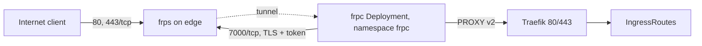

# Edge and public ingress

`home-server` takes no inbound connections from the internet. Public traffic
enters at the edge VPS and reaches Traefik through a tunnel the cluster dials
out:

## The edge VPS

| What | Value |
| --- | --- |
| Server | Hetzner Cloud `edge`, type `cx22`, location `nbg1`, `49.12.197.36` |
| DNS | `hertzner.luukblankenstijn.nl` A record to the server, `*.luukblankenstijn.nl` CNAME to that name, both unproxied |
| OS | NixOS from `nixosConfigurations.edge` (`nix/hosts/edge`) |
| Login | user `luuk`, keys from `https://github.com/LuukBlankenstijn.keys`, passwordless sudo, no root login, no passwords; see [NixOS hosts](../hosts.md) |

`terraform/10_edge` owns the server, its Hetzner firewall and both DNS records.
`image`, `ssh_keys`, `user_data` and `public_net` are in `ignore_changes`, and
the server has `prevent_destroy`; the operating system is entirely the NixOS
configuration.

### Ports have one source

`nix/hosts/edge/ports.json` lists every open port:

| Key | Port | Used by |
| --- | --- | --- |
| `ssh` | 22/tcp | sshd |
| `frpControl` | 7000/tcp | frps control connection |
| `forwardedTcp` | 80/tcp, 443/tcp | frps public listeners |
| `stun` | 3478/udp | coturn |

The NixOS modules read it for the host firewall and the service configuration;
`terraform/10_edge/server.tf` reads it for the Hetzner firewall (plus ICMP). A
port changes in that file only.

### Services on the host

- **frps** (`frp.nix`, unit `frp-edge.service`): binds `frpControl`, token
  authentication, `transport.tls.force`, and only allows proxies on the
  `forwardedTcp` ports. The token is `frp-token` from `secrets/edge.yaml`,
  decrypted by sops-nix with the host's `/etc/ssh/ssh_host_ed25519_key` and
  passed as `FRP_TOKEN` through an environment file; a changed token restarts the
  unit.
- **coturn** (`stun.nix`): STUN only on 3478/udp; no TCP, TLS, DTLS, CLI or TURN
  relay. NetBird peers use it as `stun:hertzner.luukblankenstijn.nl:3478`.

### Deploying the host

comin deploys `main`; building, manual deploys and the sops recipient are on
[NixOS hosts](../hosts.md).

## The tunnel

`flux/40_services/frpc` runs one `frpc` (`fatedier/frpc`) that connects to
`hertzner.luukblankenstijn.nl:7000` over TLS with the same token, read from
OpenBao `secret/frpc/frpc` through the `secret` SecretStore. It registers two
TCP proxies:

| Proxy | Edge port | Target |
| --- | --- | --- |
| `http` | 80 | `traefik-traefik.traefik.svc.cluster.local:80` |
| `https` | 443 | `traefik-traefik.traefik.svc.cluster.local:443` |

Both prepend a PROXY protocol v2 header. `loginFailExit = false` keeps frpc
retrying while the edge is unreachable.

The Deployment has one replica and `strategy: Recreate`. frps rejects a second
client registering a proxy name that is already registered, so two frpc pods
must never overlap.

## Traefik

Traefik (`flux/20_controllers/traefik`) runs as a DaemonSet with
`externalTrafficPolicy: Local`. Entrypoints `web` and `websecure` accept PROXY
protocol from `10.42.0.0/16`, the pod CIDR frpc connects from, so applications
see the real client address. `web` redirects to `websecure`. TLS uses the default
TLSStore certificate `wildcard-luukblankenstijn-nl-tls` (`luukblankenstijn.nl`
and `*.luukblankenstijn.nl`, Let's Encrypt DNS-01 through Cloudflare, ClusterIssuer
`letsencrypt-dns`).

The edge forwards only 80 and 443. Other Traefik entrypoints (`minecraft`,
`voicechat-udp`) are reachable on the node's LAN address only.
