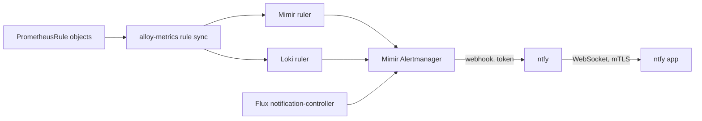

# Alerting

Alerts go from Mimir's built-in Alertmanager to a self-hosted ntfy, which pushes
them to the phone. Grafana's own alerting is not used.



## Rules

Every rule is a `monitoring.coreos.com/v1` PrometheusRule. Only the CRDs are
installed (`flux/20_controllers/prometheus-operator-crds`); there is no
Prometheus Operator. `alloy-metrics` loads them into the rulers:

| Component | Picks up | Loads into |
| --- | --- | --- |
| `mimir.rules.kubernetes` | every PrometheusRule without label `rules.luukblankenstijn.nl/backend: loki` | Mimir ruler, namespace `alloy/<namespace>/<name>/<uid>` |
| `loki.rules.kubernetes` | PrometheusRules with that label (LogQL) | Loki ruler |

Mimir keeps the rules in S3 (`luuk-mimir`, prefix `ruler`) and evaluates them
in the same process as the Alertmanager (`-ruler.alertmanager-url=http://127.0.0.1:8080/alertmanager`).
Loki's ruler sends to the same Alertmanager.

| Source | File |
| --- | --- |
| Kubernetes, node and kube-state-metrics rules from kube-prometheus-stack, installed rules-only | `flux/50_apps/observability/rules/kube-prometheus-stack.yaml` |
| Flux, certificates, ingress, OpenBao, external-secrets, device certificates | `rules/platform.yaml` |
| Postgres, MariaDB, Longhorn, their backups and the weekly restore test | `rules/data.yaml` |
| edge and home-gateway reporting, disks, GPU, the KVM device, comin, the frp tunnel | `rules/infra.yaml` |
| public endpoints probed from inside the cluster; Home Assistant, mosquitto and Android emulator workloads | `rules/apps.yaml` |
| Alertmanager, rulers, ingestion, ntfy, Alloy | `rules/meta.yaml` |
| login failures and SSH logins, from logs | `rules/security.yaml` (Loki) |

The kube-prometheus-stack release disables everything but `defaultRules`, drops
the groups for components k3s does not expose separately (etcd, scheduler,
controller-manager, proxy) and those for Prometheus and the operator, and
disables `KubeCPUOvercommit`/`KubeMemoryOvercommit` (always firing on one node),
`CPUThrottlingHigh` and the RAID alerts.

### Labels

Every alert carries:

| Label | Values | Effect |
| --- | --- | --- |
| `severity` | `critical`, `warning`, `info` (Flux events: `error`, `info`) | ntfy priority and repeat interval |
| `group` | `infra`, `platform`, `data`, `apps`, `security`, `meta` | ntfy topic `alerts-<group>` |

Own rules set `group` on the rule group (Mimir) or on each rule (Loki);
kube-prometheus-stack groups get it through `defaultRules.additionalRuleGroupLabels`.
An alert without `group` goes to `alerts-platform`.

## Alertmanager

Mimir runs the Alertmanager in its monolithic process (`-target=all,alertmanager`),
one replica (`-alertmanager.sharding-ring.replication-factor=1`), state on the
Mimir volume under `/data/alertmanager`.

The configuration is not stored through the API. It is the read-only local store
`-alertmanager-storage.local.path=/etc/mimir/alertmanager`, a mount of Secret
`observability/alertmanager-config` whose key `anonymous.yaml` is the tenant's
config. ExternalSecret `alertmanager-config` renders it from
`flux/50_apps/observability/alertmanager/external-secrets.yaml` with the ntfy
token from OpenBao `secret/observability/alertmanager`. Mimir re-reads it every
15 seconds, so a merged change is live without a restart. Mimir logs a warning
that the local store cannot persist state between replicas; with one replica
that is expected.

| Severity | ntfy priority | Repeats while firing | Night 23:00–08:00 (Europe/Amsterdam) |
| --- | --- | --- | --- |
| `critical` | 5 | every 2 h | delivered |
| `warning`, `error` | 4 | every 12 h | held until 08:00 |
| `info` | 2 | every 7 days | delivered |

Resolved notifications are sent at priority 2. Alerts are grouped by
`alertname` and `namespace`, 30 s group wait, 5 min group interval.

Inhibitions: a `critical` alert silences `warning` and `info` alerts with the same
`alertname`, `namespace` and `instance`; a `warning` silences `info` the same way;
kube-prometheus-stack's `InfoInhibitor` silences `info` alerts in its namespace.
`InfoInhibitor` and Flux `info` events go to a receiver without integrations.
`Watchdog` goes to the heartbeat (below).

Grafana has the Alertmanager as data source `Alertmanager` (implementation
`mimir`): Alerting → Alert groups and Silences show and change it. Mimir's rules
appear under Alerting → Alert rules through the `Mimir` data source.

To send a test alert:

```sh
kubectl -n observability port-forward sts/mimir 18080:8080 &
curl -XPOST -H 'Content-Type: application/json' \
  http://localhost:18080/alertmanager/api/v2/alerts \
  -d '[{"labels":{"alertname":"Test","group":"meta","severity":"info"},"annotations":{"summary":"test"}}]'
```

## Heartbeat from outside

Everything above runs at home, so a dead home-server or home internet would be
silent. kube-prometheus-stack's always-firing `Watchdog` covers that:

1. The Alertmanager posts it every 5 minutes to ntfy topic `heartbeat`
   (receiver `heartbeat`, priority 1; nobody subscribes to it).
2. On the edge VPS, timer `home-heartbeat-check` (`nix/hosts/edge/heartbeat.nix`)
   polls `https://ntfy.luukblankenstijn.nl/heartbeat/json?poll=1&since=10m`
   every 5 minutes, with the edge's own client certificate (`cfg.deviceCert`,
   read through group `device-cert`) and ntfy user `edge` (read-only on
   `heartbeat`).
3. If that returns nothing or fails, it posts once, at priority 5, to a topic on
   the public `https://ntfy.sh`, and posts again when the heartbeat returns.

The topic name and the `edge` token are in `secrets/edge.yaml`
(`outside-alert-topic`, `ntfy-heartbeat-token`); `40_openbao-config` copies the
token into `secret/ntfy/ntfy`. Subscribe to that topic in the app on server
`https://ntfy.sh`; anyone who knows the name can read it, so it is long and
random and the messages say nothing beyond "home is unreachable".

It fires when home-server, the home connection, the frp tunnel, Traefik, Mimir's
Alertmanager or ntfy is down. It cannot report the edge itself being down.

## Flux

notification-controller is enabled in the FluxInstance. Provider `alertmanager`
and Alert `alertmanager` in `flux-system`
(`flux/50_apps/observability/flux-notifications`) forward `error` events of the
FluxInstance, the GitRepository, the Kustomizations and the HelmReleases in
`flux-system` as alerts with `group="platform"`. They carry no end time and
resolve after the Alertmanager's `resolve_timeout` of one hour.

Every other Flux object is covered by `FluxResourceNotReady`, which reads
flux-operator's `flux_resource_info` and fires after 15 minutes not ready.

## ntfy

`https://ntfy.luukblankenstijn.nl`, namespace `ntfy` (`flux/50_apps/ntfy`), image
`binwiederhier/ntfy`, SQLite cache and user database on a 1 Gi Longhorn volume,
messages kept 72 hours.

The IngressRoute uses TLS option `traefik/device-mtls`: only clients with a
certificate from the hosts or a phone intermediate get through (see
[Ingest from devices](index.md#ingest-from-devices)). Inside the cluster the
Alertmanager uses Service `ntfy.ntfy.svc` directly.

Access is `deny-all` by default and defined in `server.yml`, rendered by
ExternalSecret `ntfy-config` from OpenBao `secret/ntfy/ntfy`:

| User | Role | Access | Credential |
| --- | --- | --- | --- |
| `luuk` | admin | everything | password `luuk_password` |
| `alertmanager` | user | write-only `alerts-*` | token `alertmanager_token` |

`40_openbao-config` generates the password, its bcrypt hash and the token.
The Alertmanager posts with `?template=alertmanager`; the ConfigMap
`ntfy-templates` overrides ntfy's built-in template of that name so the title
carries a severity marker and the priority follows `severity`. The tag shown in
the notification is fixed per topic.

### Phone setup

1. Bundle the phone certificate as in [Phones](index.md#phones) and import it in
   the ntfy app under Settings → Advanced → Manage certificates.
2. Settings → Manage users: service URL `https://ntfy.luukblankenstijn.nl`,
   user `luuk`, the password from `secret/ntfy/ntfy`.
3. Subscribe to `alerts-infra`, `alerts-platform`, `alerts-data`, `alerts-apps`,
   `alerts-security` and `alerts-meta` on that server.

The app keeps a WebSocket open to the server; no Google or ntfy.sh service is
involved.

The phone certificate expires after a year. `PhoneCertificateExpiringSoon` fires
30 days before (warning) and 7 days before (critical), from
x509-certificate-exporter (`flux/50_apps/observability/certificates`) reading
Secret `device-certificates`, which `50_pki` fills with the public certificates
through `secret/observability/device-certificates`. In those last 30 days an
apply of `50_pki` issues a new certificate; bundle and import it again.

## What is collected for the rules

Beyond the jobs in [In-cluster collection](index.md#in-cluster-collection):

| Signal | Source |
| --- | --- |
| Public endpoints and their certificates | Alloy's blackbox exporter, HTTPS probes of Authentik, Vaultwarden, Grafana, Grimmory, Shelfmark, NetBird, OpenBao, Longhorn and the Android emulator, and a TLS 1.3 probe of `mqtt.luukblankenstijn.nl:443`, through public DNS, so through the edge and the tunnel; `job="blackbox"`, `instance=<host>`. The MQTT probe completes the handshake before mosquitto rejects the missing client certificate, so it still measures the served certificate |
| zigbee2mqtt connection | `mqtt-exporter` in namespace `home-assistant`, `zigbee2mqtt_bridge_online` from the retained `zigbee2mqtt/bridge/state` |
| frp proxies per name | `frp_server_proxy_counts_detailed{type, name}` from frps; `FrpTunnelDown` watches `http` and `https` |
| Postgres and its backups | PodMonitor `postgres/postgres` (CNPG instance metrics incl. `barman_cloud_*`) |
| MariaDB | mysqld-exporter deployed by mariadb-operator (`spec.metrics.enabled`) |
| MariaDB and Longhorn backup schedule | kube-state-metrics Job and CronJob metrics |
| Allocatable `squat.ai/kvm` on `home-server` | kube-state-metrics `kube_node_status_allocatable{resource="squat_ai_kvm"}` |
| Longhorn | chart ServiceMonitor |
| OpenBao, external-secrets, Authentik, mariadb-operator, CNPG operator, CoreDNS | ServiceMonitors / PodMonitors |
| comin, disk SMART, GPU on `home-server` | NixOS exporters on the node (`nix/hosts/home-server`), scraped by `alloy-metrics` on ports 4243, 9633 and 9835 |
| comin and frps on `edge`, comin on `home-gateway`; `up{job="node-exporter"}` per host, which `EdgeNotReporting` and `HomeGatewayNotReporting` watch | the host's Alloy (`cfg.services.alloy.scrapeTargets`) |
