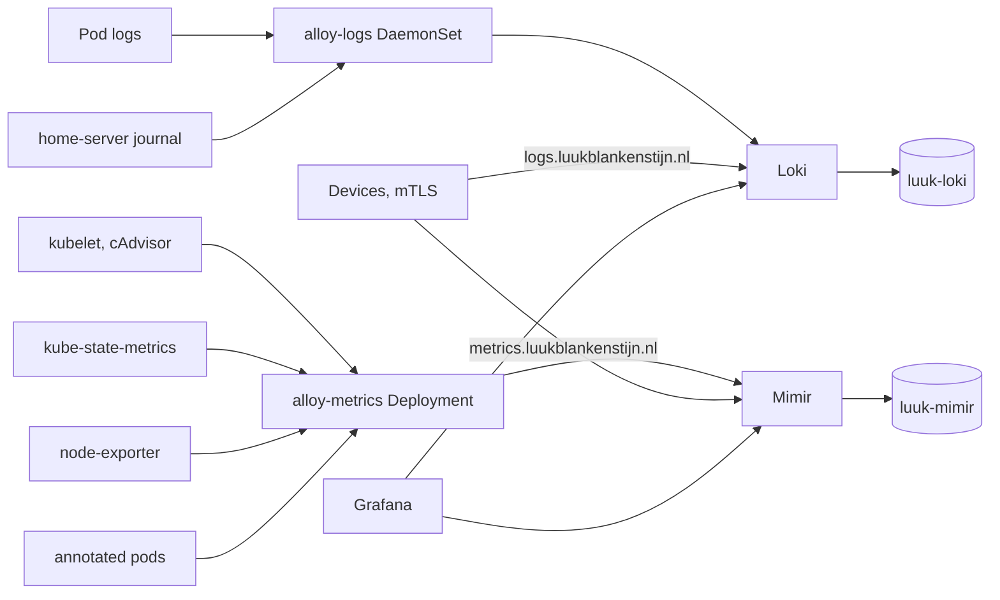
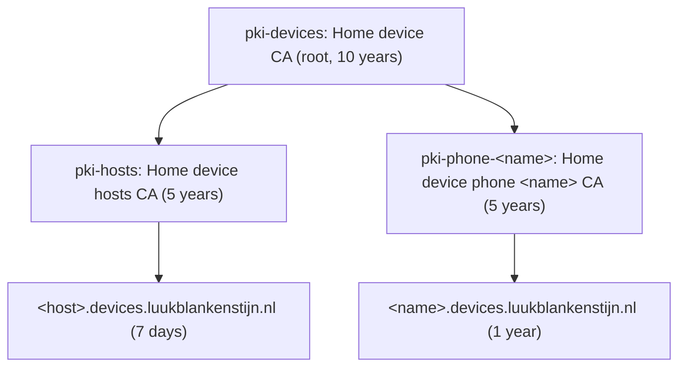

# Observability

Metrics and logs for the cluster and for devices outside it: Grafana, Loki,
Mimir, two Alloy collectors and kube-state-metrics in namespace
`observability` (`flux/50_apps/observability`, layer `apps`), and the node
exporter in namespace `node-exporter` (`flux/40_services/node-exporter`, layer
`services`). There are no traces.



## Components

| Component | Source | Version | Local state |
| --- | --- | --- | --- |
| Grafana | chart `grafana` from `grafana-community` | `12.10.4` | none; Postgres `grafana` |
| Loki | chart `loki` from `grafana`, `SingleBinary` | `7.2.0` | 5 Gi `longhorn` (WAL, index staging, compactor) |
| Mimir | hand-written StatefulSet, image `grafana/mimir` | `3.1.2` | 5 Gi `longhorn` (TSDB head, store-gateway sync, compactor) |
| `alloy-logs` | chart `alloy` from `grafana`, DaemonSet | `1.11.1` | - |
| `alloy-metrics` | chart `alloy` from `grafana`, Deployment | `1.11.1` | - |
| kube-state-metrics | chart `kube-state-metrics` from `prometheus-community` | `8.2.0` | - |
| node-exporter | chart `prometheus-node-exporter` from `prometheus-community`, host network and PID | `4.56.1` | - |

Everything runs one replica. Mimir runs monolithic (`-target=all`) and is
configured entirely by container arguments, so a changed flag rolls the pod.
Its ruler reads rules from an empty directory; there is no Alertmanager and no
alerting.

Both stores are single-tenant: Loki runs with `auth_enabled: false` and Mimir
with `-auth.multitenancy-enabled=false` (every series lands in tenant
`anonymous`). Clients send no `X-Scope-OrgID`.

## Storage and retention

| Store | Bucket | Prefix | Retention |
| --- | --- | --- | --- |
| Loki | `luuk-loki` | chunks, index and ruler share the bucket | 30 days, `limits_config.retention_period: 720h` applied by the compactor |
| Mimir | `luuk-mimir` | `blocks` | 30 days, `-compactor.blocks-retention-period=30d` |

The buckets live on Hetzner Object Storage (`fsn1.your-objectstorage.com`,
region `fsn1`, path-style) and are created by `terraform/40_s3-buckets`.
Retention is enforced in the applications, not by bucket lifecycle rules.

Only the access keys come from OpenBao: `s3/observability/loki` and
`s3/observability/mimir`, read through SecretStore `s3` into the Secrets
`loki-s3` and `mimir-s3`. Endpoint, region and bucket are plain values in the
manifests. Loki expands the keys with `-config.expand-env=true`; Mimir receives
them through `$(VAR)` argument expansion.

## In-cluster collection

`home-server` itself needs no certificate: it is covered by the in-cluster
collectors.

`alloy-logs` (DaemonSet) ships:

- every container's log through the Kubernetes API (`loki.source.kubernetes`),
  labelled `namespace`, `pod`, `container`, `app` and `node`;
- the node's systemd journal (`loki.source.journal`), from read-only host mounts
  of `/var/log/journal`, `/run/log/journal` and `/etc/machine-id`, labelled
  `host="home-server"` and `unit`.

`alloy-metrics` (Deployment) scrapes every 60 seconds:

| Job | Target |
| --- | --- |
| `kubelet`, `cadvisor` | each node's kubelet on 10250, `/metrics` and `/metrics/cadvisor` |
| `kube-state-metrics` | Service `observability/kube-state-metrics`, port `http` |
| `node-exporter` | the node-exporter pods on 9100; host metrics of `home-server` |
| `<namespace>/<app>` | every pod annotated `prometheus.io/scrape: "true"` |

A pod is scraped only when `prometheus.io/port` names a port the pod declares as
a `containerPort`; `prometheus.io/path` overrides `/metrics`. Grafana, Loki,
Mimir and both Alloys annotate themselves.

Both collectors add `cluster="home"` to everything they send.

Alloy's chart default lets it read every Secret and ConfigMap in the cluster;
both releases replace `rbac.rules` with only what their discovery and log
tailing need.

## Grafana

`https://grafana.luukblankenstijn.nl`, IngressRoute `observability/grafana`.

Login is Authentik only (`disable_login_form`). The OAuth2 provider and
application `grafana` are in `terraform/50_authentik-config/grafana.tf`; the
client credentials reach Grafana from OpenBao `authentik/observability/grafana`
through SecretStore `authentik` (role `authentik-observability`) as
`GF_AUTH_GENERIC_OAUTH_CLIENT_ID`/`_SECRET`. Members of the Authentik group
`authentik Admins` become Grafana server admins (`GrafanaAdmin`); everyone
else who can log in is a `Viewer`. The role is synced on every login.

State is Postgres database `grafana` (`postgres/observability/grafana`,
SecretStore `postgres`), connected with `sslmode=verify-full` against the system
roots. The local `admin` user's password is generated by the chart into the
Secret `observability/grafana`; with the login form disabled it is only useful
for the HTTP API.

Provisioned from the HelmRelease values:

- datasources `Mimir` (Prometheus type, uid `mimir`, default) at
  `http://mimir.observability.svc.cluster.local:8080/prometheus` and `Loki`
  (uid `loki`) at `http://loki.observability.svc.cluster.local:3100`;
- dashboards downloaded from grafana.com on every pod start by revision:
  Node Exporter Full (`1860`) and the Kubernetes Views
  (`15757`, `15758`, `15759`, `15760`). They are read-only; copy one to change it.

## Ingest from devices

Devices outside the cluster push straight to Loki and Mimir through the edge
and Traefik:

| Host | Path | Backend |
| --- | --- | --- |
| `logs.luukblankenstijn.nl` | `/loki/api/v1/push` | `observability/loki:3100` |
| `metrics.luukblankenstijn.nl` | `/api/v1/push` | `observability/mimir:8080` |

Only these exact paths are routed; queries are not reachable from outside. Both
IngressRoutes (`observability/loki-ingest`, `observability/mimir-ingest`)
reference the TLSOption `traefik/device-mtls`, which requires a client
certificate (`RequireAndVerifyClientCert`, TLS 1.2 minimum) that chains to one
of the CAs in the Secret `traefik/device-ca`. A connection without one fails the
TLS handshake. The TLS options apply by SNI, so the same hostnames reached with
another SNI are answered with 421.

The TLSOption, the Secret's ExternalSecret and its SecretStore live in
namespace `traefik` but are applied from `flux/50_apps/observability/ingest`,
because the `config` layer, where the rest of the Traefik configuration sits,
runs before OpenBao and external-secrets are usable.

### Device CA

`terraform/50_pki` builds the hierarchy in OpenBao:



All keys are EC P-256. Traefik never trusts the root. `50_pki` writes `ca.crt`
at `secret/observability/device-ca`: the hosts intermediate followed by every
phone intermediate. SecretStore `traefik/pki` reads it with role `pki-traefik`
(policy `pki-traefik-device-ca`, bound to namespace `traefik`), and
ExternalSecret `traefik/device-ca` refreshes it every 5 minutes. Revocation is
therefore never a CRL lookup (Traefik checks none): a CA that is not in
`ca.crt` is not accepted.

### Hosts

Hosts renew their own certificate from OpenBao. For every entry in
`local.hosts` (`zenbook`, `thinkpad`, `home-assistant`, `edge`), the root
creates:

- PKI role `pki-hosts/roles/<host>`: client certificates only, CN exactly
  `<host>.devices.luukblankenstijn.nl`, TTL and max TTL 168 hours,
  `no_store` (issued certificates are not kept in OpenBao);
- policy `device-<host>`: `update` on `pki-hosts/issue/<host>` and nothing
  else;
- AppRole `device-<host>` on auth mount `approle` with that policy (1-hour
  tokens) and one SecretID.

```sh
tofu -chdir=terraform/50_pki output -json host_approles
```

prints `role_id` and `secret_id` per host. What a host needs to renew:

| Setting | Value |
| --- | --- |
| OpenBao address | `https://openbao.luukblankenstijn.nl` (public IngressRoute `openbao/openbao`) |
| Auth | AppRole, mount `approle`, the host's `role_id` and `secret_id` |
| Issue | `pki-hosts/issue/<host>` with `common_name=<host>.devices.luukblankenstijn.nl` |
| Certificate lifetime | 7 days; renew well before that |

The host side (OpenBao Agent rendering the certificate, the AppRole
credentials delivered by sops-nix, and Alloy on the host) belongs in the
`nix-config` repository and is not part of this repository.

Removing a host from `local.hosts` and applying deletes its AppRole, policy and
PKI role. The host can no longer renew, and its last certificate expires within
7 days.

### Phones

Each entry in `local.phones` (currently `phone`) gets its own intermediate on
mount `pki-phone-<name>` and one client certificate for
`<name>.devices.luukblankenstijn.nl`, valid 1 year and issued by OpenTofu.

```sh
tofu -chdir=terraform/50_pki output -json phone_certificates > phone.json
jq -r '.phone.certificate' phone.json > phone.crt
jq -r '.phone.private_key' phone.json > phone.key
jq -r '.phone.ca_chain' phone.json > phone-ca.crt
openssl pkcs12 -export -legacy -inkey phone.key -in phone.crt \
  -certfile phone-ca.crt -name phone -out phone.p12
```

`-legacy` encrypts the bundle with 3DES and SHA-1 instead of OpenSSL 3's
default AES-256/PBKDF2, which many Android and iOS certificate installers
reject as a wrong password. Without the legacy provider, use
`-keypbe PBE-SHA1-3DES -certpbe PBE-SHA1-3DES -macalg sha1` instead.

Import `phone.p12` on the phone, then delete `phone.json`, `phone.key`,
`phone.crt`, `phone-ca.crt` and `phone.p12`.

Renewal is yearly: the certificate resource has `auto_renew` with 30 days
`min_seconds_remaining`, so an apply within the last 30 days issues a new one;
export and import it again.

Revocation: remove the phone from `local.phones` and apply. Its mount and
intermediate are deleted, `ca.crt` is rewritten without it, and Traefik rejects
the phone as soon as ExternalSecret `traefik/device-ca` refreshes (at most 5
minutes). To make it immediate, force the refresh right after the apply:

```sh
kubectl -n traefik annotate externalsecret device-ca force-sync=$(date +%s) --overwrite
```

## Applying from scratch

1. `40_s3-buckets` (buckets and keys) and `40_databases` (database `grafana`).
2. `50_authentik-config` (OAuth2 client, `authentik-observability`).
3. `50_pki` (CA hierarchy, `secret/observability/device-ca`, `pki-traefik`,
   AppRoles).
4. Flux: `services` brings node-exporter, `apps` the rest. Until the OpenBao
   paths exist, the ExternalSecrets fail and the releases that need them
   retry.
